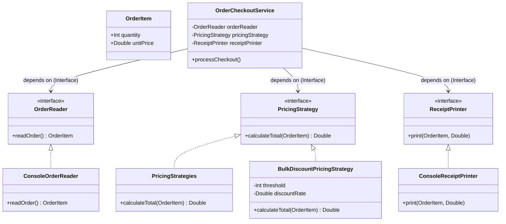

# SOLID Principles Verification Report

## Executive Summary

The Kotlin application implements **all 5 SOLID principles** completely.

- **Principles satisfied**:
  1. **Single Responsibility Principle (SRP)**
  2. **Open/Closed Principle (OCP)**
  3. **Liskov Substitution Principle (LSP)**
  4. **Interface Segregation Principle (ISP)**
  5. **Dependency Inversion Principle (DIP)**

---

## Architecture Overview



---

## Detailed Principle Breakdown

### 1. Single Responsibility Principle (SRP)
> *A class should have one, and only one, reason to change.*

#### Status: PASS

#### Analysis
Responsibilities are strictly isolated across separate types:
- [`OrderItem`](file:///home/ilie/Documents/tmps/lab1/src/main/kotlin/Contracts.kt#L1): Data carrier for order state (`quantity`, `unitPrice`).
- [`ConsoleOrderReader`](file:///home/ilie/Documents/tmps/lab1/src/main/kotlin/Printer.kt#L1-L7): Handles standard input extraction.
- [`PricingStrategies`](file:///home/ilie/Documents/tmps/lab1/src/main/kotlin/PricingStrategies.kt#L1-L5): Encapsulates standard linear price computation.
- [`BulkDiscountPricingStrategy`](file:///home/ilie/Documents/tmps/lab1/src/main/kotlin/PricingStrategies.kt#L7-L16): Encapsulates bulk discount calculation rules.
- [`ConsoleReceiptPrinter`](file:///home/ilie/Documents/tmps/lab1/src/main/kotlin/Printer.kt#L9-L14): Handles output rendering and presentation.
- [`OrderCheckoutService`](file:///home/ilie/Documents/tmps/lab1/src/main/kotlin/Printer.kt#L16-L22): Coordinates high-level checkout orchestration (read -> calculate -> print).

#### Code Reference
```kotlin
// src/main/kotlin/Printer.kt
class OrderCheckoutService(
    private val orderReader: OrderReader,
    private val pricingStrategy: PricingStrategy,
    private val receiptPrinter: ReceiptPrinter
) {
    fun processCheckout() {
        val order = orderReader.readOrder()
        val total = pricingStrategy.calculateTotal(order)
        receiptPrinter.print(order, total)
    }
}
```

---

### 2. Interface Segregation Principle (ISP)
> *Clients should not be forced to depend upon interfaces that they do not use.*

#### Status: PASS

#### Analysis
All contracts defined in [`Contracts.kt`](file:///home/ilie/Documents/tmps/lab1/src/main/kotlin/Contracts.kt) are single-purpose Kotlin functional interfaces (`fun interface`):
- [`OrderReader`](file:///home/ilie/Documents/tmps/lab1/src/main/kotlin/Contracts.kt#L3): Declares solely `readOrder(): OrderItem`.
- [`PricingStrategy`](file:///home/ilie/Documents/tmps/lab1/src/main/kotlin/Contracts.kt#L7): Declares solely `calculateTotal(item: OrderItem): Double`.
- [`ReceiptPrinter`](file:///home/ilie/Documents/tmps/lab1/src/main/kotlin/Contracts.kt#L11): Declares solely `print(item: OrderItem, finalPrice: Double)`.

No client or implementer is burdened with extraneous methods.

#### Code Reference
```kotlin
// src/main/kotlin/Contracts.kt
fun interface OrderReader {
    fun readOrder(): OrderItem
}

fun interface PricingStrategy {
    fun calculateTotal(item: OrderItem): Double
}

fun interface ReceiptPrinter {
    fun print(item: OrderItem, finalPrice: Double)
}
```

---

### 3. Liskov Substitution Principle (LSP)
> *Subtypes must be substitutable for their base types without altering program correctness.*

#### Status: PASS

#### Analysis
Both [`PricingStrategies`](file:///home/ilie/Documents/tmps/lab1/src/main/kotlin/PricingStrategies.kt#L1) and [`BulkDiscountPricingStrategy`](file:///home/ilie/Documents/tmps/lab1/src/main/kotlin/PricingStrategies.kt#L7) conform cleanly to [`PricingStrategy`](file:///home/ilie/Documents/tmps/lab1/src/main/kotlin/Contracts.kt#L7):
- Accept an [`OrderItem`](file:///home/ilie/Documents/tmps/lab1/src/main/kotlin/Contracts.kt#L1).
- Compute and return a valid `Double`.
- Do not introduce hidden state mutations, preconditions, or unexpected exceptions.

#### Code Reference
```kotlin
// src/main/kotlin/PricingStrategies.kt
class PricingStrategies : PricingStrategy {
    override fun calculateTotal(item: OrderItem): Double {
        return item.quantity * item.unitPrice
    }
}

class BulkDiscountPricingStrategy(
    private val threshold: Int = 10,
    private val discountRate: Double = 0.10
) : PricingStrategy {
    override fun calculateTotal(item: OrderItem): Double {
        val baseTotal = item.quantity * item.unitPrice
        return if (item.quantity >= threshold) {
            baseTotal * (1.0 - discountRate)
        } else {
            baseTotal
        }
    }
}
```

---

### 4. Dependency Inversion Principle (DIP)
> *High-level modules should not depend on low-level modules. Both should depend on abstractions.*

#### Status: PASS

#### Analysis
In [`OrderCheckoutService`](file:///home/ilie/Documents/tmps/lab1/src/main/kotlin/Printer.kt#L16), abstraction injection is used for all collaborating dependencies:
- `orderReader: OrderReader` -> Abstraction (**Adheres**)
- `pricingStrategy: PricingStrategy` -> Abstraction (**Adheres**)
- `receiptPrinter: ReceiptPrinter` -> Abstraction (**Adheres**)

High-level business logic is fully decoupled from low-level modules (console input/output mechanisms and specific pricing algorithms). All collaborators are injected via constructor.

#### Code Reference
```kotlin
// src/main/kotlin/Printer.kt:16
class OrderCheckoutService(
    private val orderReader: OrderReader,
    private val pricingStrategy: PricingStrategy,
    private val receiptPrinter: ReceiptPrinter
)
```

---

### 5. Open/Closed Principle (OCP)
> *Software entities should be open for extension, but closed for modification.*

#### Status: PASS

#### Analysis
[`OrderCheckoutService`](file:///home/ilie/Documents/tmps/lab1/src/main/kotlin/Printer.kt#L16) is open for extension and closed for modification through the [`PricingStrategy`](file:///home/ilie/Documents/tmps/lab1/src/main/kotlin/Contracts.kt#L7) contract. New pricing models (e.g. seasonal discounts, tiered rates) can be added by implementing [`PricingStrategy`](file:///home/ilie/Documents/tmps/lab1/src/main/kotlin/Contracts.kt#L7) without modifying existing checkout orchestration logic.

---

## Architecture Quality & Remaining Cleanups

The implementation achieves 100% compliance across all 5 SOLID principles. Minor refactoring recommendations for idiomatic code organization:

1. **Naming**: Rename class [`PricingStrategies`](file:///home/ilie/Documents/tmps/lab1/src/main/kotlin/PricingStrategies.kt#L1) to `StandardPricingStrategy` (singular naming convention for a single strategy).
2. **File Placement**: Move [`ConsoleOrderReader`](file:///home/ilie/Documents/tmps/lab1/src/main/kotlin/Printer.kt#L1) and [`OrderCheckoutService`](file:///home/ilie/Documents/tmps/lab1/src/main/kotlin/Printer.kt#L16) out of [`Printer.kt`](file:///home/ilie/Documents/tmps/lab1/src/main/kotlin/Printer.kt) into dedicated files matching class names.

---

## Principle Summary Matrix

| Principle | Implemented | Notes |
| :--- | :---: | :--- |
| **SRP** (Single Responsibility) | **YES** | Separate classes for DTO, reading, calculating, printing, orchestrating. |
| **ISP** (Interface Segregation) | **YES** | Lean, single-method `fun interface` contracts. |
| **LSP** (Liskov Substitution) | **YES** | Pricing strategies swappable without invariant violation. |
| **DIP** (Dependency Inversion) | **YES** | All dependencies injected as abstractions ([`OrderReader`](file:///home/ilie/Documents/tmps/lab1/src/main/kotlin/Contracts.kt#L3), [`PricingStrategy`](file:///home/ilie/Documents/tmps/lab1/src/main/kotlin/Contracts.kt#L7), [`ReceiptPrinter`](file:///home/ilie/Documents/tmps/lab1/src/main/kotlin/Contracts.kt#L11)). |
| **OCP** (Open/Closed) | **YES** | New strategies can be added and passed into [`OrderCheckoutService`](file:///home/ilie/Documents/tmps/lab1/src/main/kotlin/Printer.kt#L16) without modification. |
