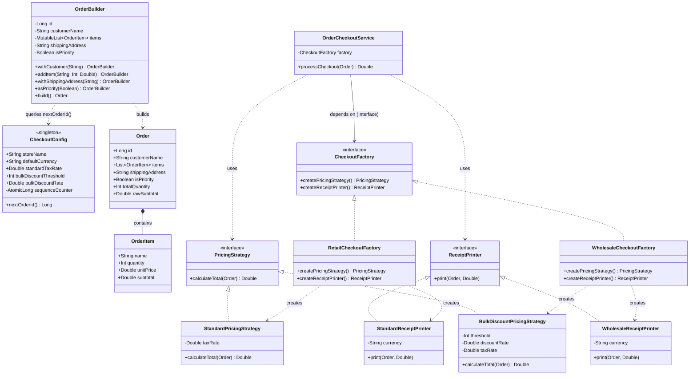

# Creational Design Patterns Verification Report

## Executive Summary

This project continues the checkout and order-processing architecture from Lab 0 (SOLID Principles) by implementing **3 Creational Design Patterns** in Kotlin:

- **Patterns implemented**:
  1. **Singleton Pattern** ([`CheckoutConfig`](file:///home/ilie/Documents/tmps/lab1/src/main/kotlin/OrderConfig.kt#L10))
  2. **Builder Pattern** ([`OrderBuilder`](file:///home/ilie/Documents/tmps/lab1/src/main/kotlin/OrderBuilder.kt#L8))
  3. **Abstract Factory Pattern** ([`CheckoutFactory`](file:///home/ilie/Documents/tmps/lab1/src/main/kotlin/Contracts.kt#L22))

---

## Architecture Overview



---

## Detailed Pattern Breakdown

### 1. Singleton Pattern
> *Ensure a class has only one instance, and provide a global point of access to it.*

#### Status: PASS

#### Motivation & Role in Domain
In an e-commerce checkout platform, operational policies such as tax rates (VAT), active business currency, bulk discount rules, and sequential transaction identifiers must be globally consistent and managed through a single source of truth. Multiple conflicting configuration instances could lead to erratic pricing, non-synchronized invoice numbering, or accounting inconsistencies.

#### Analysis & Implementation Details
The singleton is implemented via Kotlin's idiomatic [`object CheckoutConfig`](file:///home/ilie/Documents/tmps/lab1/src/main/kotlin/OrderConfig.kt#L10):
- **Thread Safety & JVM Guarantees**: Kotlin `object` declarations are initialized lazily upon first access and backed by static JVM initialization with internal classloader synchronization locks.
- **Thread-Safe State Mutation**: Sequential order generation leverages [`AtomicLong`](file:///home/ilie/Documents/tmps/lab1/src/main/kotlin/OrderConfig.kt#L18) (`incrementAndGet()`), preventing race conditions in multi-threaded transaction processing.
- **Centralized Parameters**: Holds `storeName`, `defaultCurrency`, `standardTaxRate`, `bulkDiscountThreshold`, and `bulkDiscountRate`.

#### Code Reference
```kotlin
// src/main/kotlin/OrderConfig.kt
object CheckoutConfig {
    var storeName: String = "TechStore Chisinau"
    var defaultCurrency: String = "MDL"
    var standardTaxRate: Double = 0.20 // 20% VAT
    var bulkDiscountThreshold: Int = 10
    var bulkDiscountRate: Double = 0.15 // 15% discount for bulk

    private val sequenceCounter = AtomicLong(1000L)

    fun nextOrderId(): Long = sequenceCounter.incrementAndGet()
}
```

---

### 2. Builder Pattern
> *Separate the construction of a complex object from its representation so that the same construction process can create different representations.*

#### Status: PASS

#### Motivation & Role in Domain
In Lab 0, the domain only supported a flat single-item structure (`OrderItem(quantity, unitPrice)`). In practical commerce scenarios, an `Order` is a composite domain aggregate consisting of:
- Unique identifier (`id`)
- Customer identity (`customerName`)
- List of line items (`items: List<OrderItem>`)
- Optional shipping destination (`shippingAddress`)
- Priority fulfillment flag (`isPriority`)

Direct constructor calls with multiple optional or default arguments result in constructor telescoping, fragile calling conventions, and absence of unified invariant validation. [`OrderBuilder`](file:///home/ilie/Documents/tmps/lab1/src/main/kotlin/OrderBuilder.kt#L8) solves this by enabling fluent step-by-step assembly while enforcing domain validation before creating the immutable [`Order`](file:///home/ilie/Documents/tmps/lab1/src/main/kotlin/Models.kt#L14).

#### Analysis & Implementation Details
- **Fluent Method Chaining**: Every mutator returns `OrderBuilder` via Kotlin's `apply { ... }`.
- **Precondition & Invariant Enforcement**:
  - Item quantities must be strictly positive (`quantity > 0`).
  - Unit prices must be non-negative (`unitPrice >= 0.0`).
  - `customerName` must not be blank.
  - An order must contain at least one valid item upon calling `build()`.
- **Immutability Guarantee**: Produces a read-only [`Order`](file:///home/ilie/Documents/tmps/lab1/src/main/kotlin/Models.kt#L14) with a defensive copy of items (`items.toList()`).

#### Code Reference
```kotlin
// src/main/kotlin/OrderBuilder.kt
class OrderBuilder {
    private var id: Long = CheckoutConfig.nextOrderId()
    private var customerName: String = ""
    private val items: MutableList<OrderItem> = mutableListOf()
    private var shippingAddress: String? = null
    private var isPriority: Boolean = false

    fun withCustomer(name: String): OrderBuilder = apply {
        this.customerName = name.trim()
    }

    fun addItem(name: String, quantity: Int, unitPrice: Double): OrderBuilder = apply {
        require(quantity > 0) { "Item quantity must be greater than zero: $quantity" }
        require(unitPrice >= 0.0) { "Item unit price cannot be negative: $unitPrice" }
        items.add(OrderItem(name.trim(), quantity, unitPrice))
    }

    fun withShippingAddress(address: String?): OrderBuilder = apply {
        this.shippingAddress = address?.trim()
    }

    fun asPriority(priority: Boolean = true): OrderBuilder = apply {
        this.isPriority = priority
    }

    fun build(): Order {
        require(customerName.isNotBlank()) { "Customer name is required to build an Order" }
        require(items.isNotEmpty()) { "Order must contain at least one OrderItem" }

        return Order(
            id = id,
            customerName = customerName,
            items = items.toList(),
            shippingAddress = shippingAddress,
            isPriority = isPriority
        )
    }
}
```

---

### 3. Abstract Factory Pattern
> *Provide an interface for creating families of related or dependent objects without specifying their concrete classes.*

#### Status: PASS

#### Motivation & Role in Domain
The checkout engine coordinates two distinct collaborators:
1. A [`PricingStrategy`](file:///home/ilie/Documents/tmps/lab1/src/main/kotlin/Contracts.kt#L6) (computes totals, discounts, taxes).
2. A [`ReceiptPrinter`](file:///home/ilie/Documents/tmps/lab1/src/main/kotlin/Contracts.kt#L13) (formats financial outputs).

Different business channels require corresponding pairs of implementations:
- **Standard Retail**: Needs [`StandardPricingStrategy`](file:///home/ilie/Documents/tmps/lab1/src/main/kotlin/PricingStrategies.kt#L6) (standard price + VAT) coupled with [`StandardReceiptPrinter`](file:///home/ilie/Documents/tmps/lab1/src/main/kotlin/ReceiptPrinters.kt#L6) (concise POS receipt for individual consumers).
- **Wholesale B2B**: Needs [`BulkDiscountPricingStrategy`](file:///home/ilie/Documents/tmps/lab1/src/main/kotlin/PricingStrategies.kt#L18) (volume discount applied to bulk quantities) coupled with [`WholesaleReceiptPrinter`](file:///home/ilie/Documents/tmps/lab1/src/main/kotlin/ReceiptPrinters.kt#L27) (formal commercial invoice detailing gross subtotal, volume discount deduction, tax breakdown, and shipping destination).

Pairing a wholesale pricing strategy with a retail receipt (or vice-versa) leads to broken accounting or incomplete financial receipts. The [`CheckoutFactory`](file:///home/ilie/Documents/tmps/lab1/src/main/kotlin/Contracts.kt#L22) interface guarantees that families of compatible products are always instantiated together.

#### Analysis & Implementation Details
- **Abstract Factory Contract**: [`CheckoutFactory`](file:///home/ilie/Documents/tmps/lab1/src/main/kotlin/Contracts.kt#L22) declares `createPricingStrategy(): PricingStrategy` and `createReceiptPrinter(): ReceiptPrinter`.
- **Concrete Factories**:
  - [`RetailCheckoutFactory`](file:///home/ilie/Documents/tmps/lab1/src/main/kotlin/CheckoutFactories.kt#L6): Instantiates standard retail pricing & receipt components.
  - [`WholesaleCheckoutFactory`](file:///home/ilie/Documents/tmps/lab1/src/main/kotlin/CheckoutFactories.kt#L19): Instantiates bulk wholesale pricing & commercial invoice components.
- **Client Decoupling**: [`OrderCheckoutService`](file:///home/ilie/Documents/tmps/lab1/src/main/kotlin/OrderCheckoutService.kt#L8) accepts only the [`CheckoutFactory`](file:///home/ilie/Documents/tmps/lab1/src/main/kotlin/Contracts.kt#L22) abstraction, maintaining total decoupling from concrete strategy and printer implementations.

#### Code Reference
```kotlin
// src/main/kotlin/Contracts.kt
interface CheckoutFactory {
    fun createPricingStrategy(): PricingStrategy
    fun createReceiptPrinter(): ReceiptPrinter
}

// src/main/kotlin/CheckoutFactories.kt
class RetailCheckoutFactory : CheckoutFactory {
    override fun createPricingStrategy(): PricingStrategy = StandardPricingStrategy()
    override fun createReceiptPrinter(): ReceiptPrinter = StandardReceiptPrinter()
}

class WholesaleCheckoutFactory : CheckoutFactory {
    override fun createPricingStrategy(): PricingStrategy = BulkDiscountPricingStrategy()
    override fun createReceiptPrinter(): ReceiptPrinter = WholesaleReceiptPrinter()
}

// src/main/kotlin/OrderCheckoutService.kt
class OrderCheckoutService(private val factory: CheckoutFactory) {
    fun processCheckout(order: Order): Double {
        val pricingStrategy = factory.createPricingStrategy()
        val printer = factory.createReceiptPrinter()
        val total = pricingStrategy.calculateTotal(order)
        printer.print(order, total)
        return total
    }
}
```

---

## Execution & Verification

Running [`Main.kt`](file:///home/ilie/Documents/tmps/lab1/src/main/kotlin/Main.kt#L3) demonstrates all 3 patterns interacting seamlessly with interactive input support:

```
TMPS Lab 1: Creational Design Patterns Demonstration

[1] Singleton Pattern: CheckoutConfig
Store Name: TechStore Chisinau
Active Currency: MDL
Default VAT Rate: 20.0%
Next Order ID generated: 1001

[2] Builder Pattern: Constructing Order
Enter customer name (press Enter for default 'Ion Creangă'): Ion Creangă
Is this a priority order? (y/N): n
Shipping destination (press Enter for 'Self-pickup'): 
Enter order items (press Enter on item name to finish):
  Item 1 name: Wireless Ergonomic Mouse
  Quantity (default 1): 1
  Unit price (default 100.0): 350.0
  Item 2 name: Mechanical Keyboard
  Quantity (default 1): 1
  Unit price (default 100.0): 1200.0
  Item 3 name: 

Order #1002 constructed successfully for Ion Creangă.

[3] Abstract Factory Pattern: Checkout Processing
Select checkout channel [1: Retail, 2: Wholesale B2B] (default 1): 1
RETAIL RECEIPT
Store: TechStore Chisinau
Order ID: #1002 | Customer: Ion Creangă
Priority: NO
Items:
  Wireless Ergonomic Mouse x1 @ 350.00 MDL = 350.00 MDL
  Mechanical Keyboard x1 @ 1200.00 MDL = 1200.00 MDL
Total (incl. tax): 1860.00 MDL

Execution completed. Total charged: 1860.00 MDL
```

---

## Pattern Summary Matrix

| Pattern | Implementing Types | Role & Domain Value | GoF Classification |
| :--- | :--- | :--- | :--- |
| **Singleton** | [`CheckoutConfig`](file:///home/ilie/Documents/tmps/lab1/src/main/kotlin/OrderConfig.kt#L10) | Single global source of truth for store configuration, tax rates, and atomic order sequence tracking. | Creational (Object) |
| **Builder** | [`OrderBuilder`](file:///home/ilie/Documents/tmps/lab1/src/main/kotlin/OrderBuilder.kt#L8), [`Order`](file:///home/ilie/Documents/tmps/lab1/src/main/kotlin/Models.kt#L14) | Step-by-step construction of complex orders with validation and invariant protection. | Creational (Object) |
| **Abstract Factory** | [`CheckoutFactory`](file:///home/ilie/Documents/tmps/lab1/src/main/kotlin/Contracts.kt#L22), [`RetailCheckoutFactory`](file:///home/ilie/Documents/tmps/lab1/src/main/kotlin/CheckoutFactories.kt#L6), [`WholesaleCheckoutFactory`](file:///home/ilie/Documents/tmps/lab1/src/main/kotlin/CheckoutFactories.kt#L19) | Creates coordinated families of pricing strategies and receipt formatters for specific business channels. | Creational (Object) |
