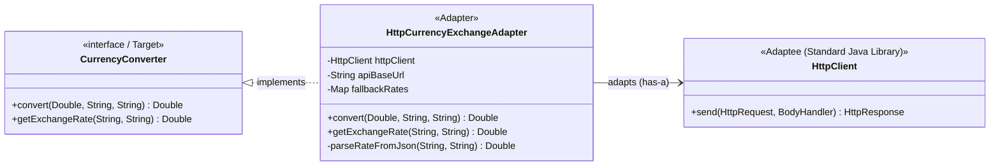
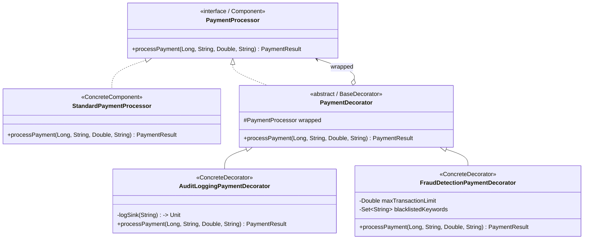
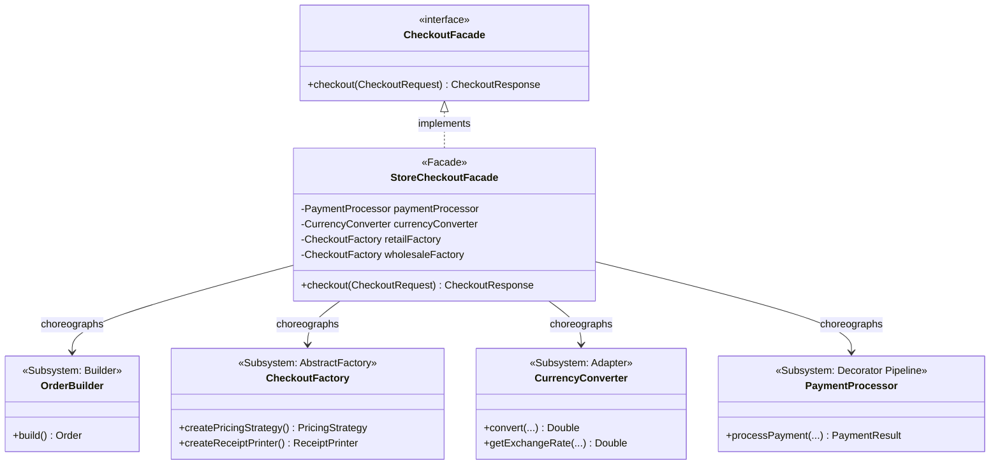
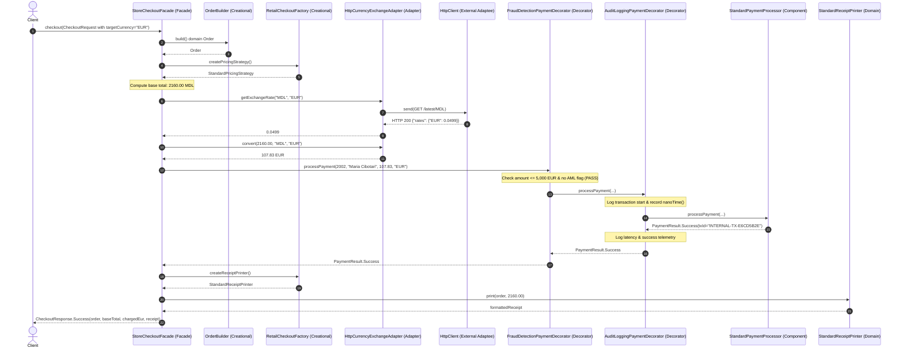

# Structural Design Patterns Verification Report

## Executive Summary

This project continues the checkout and order-processing architecture from **Lab 0 (SOLID Principles)** and **Lab 1 (Creational Design Patterns)** by implementing **3 Structural Design Patterns** in Kotlin:

- **Patterns implemented**:
  1. **Adapter Pattern** ([`HttpCurrencyExchangeAdapter`](file:///home/ilie/Documents/tmps/lab2/src/main/kotlin/com/tmps/lab2/patterns/adapter/HttpCurrencyExchangeAdapter.kt#L19-L81))
  2. **Decorator Pattern** ([`PaymentDecorator`](file:///home/ilie/Documents/tmps/lab2/src/main/kotlin/com/tmps/lab2/patterns/decorator/PaymentDecorator.kt#L8-L23), [`AuditLoggingPaymentDecorator`](file:///home/ilie/Documents/tmps/lab2/src/main/kotlin/com/tmps/lab2/patterns/decorator/AuditLoggingPaymentDecorator.kt#L7-L35), [`FraudDetectionPaymentDecorator`](file:///home/ilie/Documents/tmps/lab2/src/main/kotlin/com/tmps/lab2/patterns/decorator/FraudDetectionPaymentDecorator.kt#L8-L41))
  3. **Facade Pattern** ([`StoreCheckoutFacade`](file:///home/ilie/Documents/tmps/lab2/src/main/kotlin/com/tmps/lab2/patterns/facade/StoreCheckoutFacade.kt#L21-L85))

### Mandatory Requirements Verification
- **Full Structure**: Each pattern is implemented with its complete structural anatomy (Common component interfaces, base wrappers, multi-decorator stacking, unchangeable external Adaptee HTTP/JSON mapping, and multi-subsystem orchestration).
- **Pattern Interaction**: The primary execution path seamlessly passes across all three patterns:
  $$\text{Client} \longrightarrow \text{Facade} \longrightarrow \text{Adapter (External FX API)} \longrightarrow \text{Decorator (Fraud)} \longrightarrow \text{Decorator (Audit)} \longrightarrow \text{PaymentProcessor}$$
- **Abstraction Dependency**: Client code depends strictly on abstract interfaces (`CheckoutFacade`, `PaymentProcessor`, `CurrencyConverter`, `CheckoutFactory`), never on concrete implementation classes.
- **Open for Extension (OCP)**: New decorators (e.g. surcharge, notification), new adapters (e.g. fixed-rate or central bank API), and new checkout factories can be introduced without touching existing code.
- **Continuation of Lab 0 & Lab 1**: Direct reuse of Creational patterns (Singleton [`CheckoutConfig`](file:///home/ilie/Documents/tmps/lab2/src/main/kotlin/com/tmps/lab2/domain/CheckoutConfig.kt#L9), Builder [`OrderBuilder`](file:///home/ilie/Documents/tmps/lab2/src/main/kotlin/com/tmps/lab2/domain/OrderBuilder.kt#L7), and Abstract Factory [`CheckoutFactory`](file:///home/ilie/Documents/tmps/lab2/src/main/kotlin/com/tmps/lab2/domain/Contracts.kt#L18)) to generate and price domain orders.
- **Advanced Requirements**: Adapts an external, unchangeable HTTP client library and public REST exchange rate API ([`HttpCurrencyExchangeAdapter`](file:///home/ilie/Documents/tmps/lab2/src/main/kotlin/com/tmps/lab2/patterns/adapter/HttpCurrencyExchangeAdapter.kt#L19)) and includes 11 automated unit tests executing via a single command (`./test.sh`).

---

## Domain Description

The application models an enterprise e-commerce checkout and settlement system for **TechStore Chisinau**. The core application fulfills orders across retail consumer and B2B wholesale channels. Given a customer order request, the system constructs domain order entities with invariant checks, selects coordinated pricing and receipt strategies, performs live currency conversion via an external exchange rate service when customers pay in foreign currencies (EUR, USD), performs anti-fraud risk assessment and latency audit telemetry, securely settles payments, and emits receipts and invoices.

---

## Theoretical Overview: Structural Design Patterns

Structural design patterns explain how to assemble objects and classes into larger structures while keeping these structures flexible and efficient. Below are the definitions, intents, and analysis for all 7 structural patterns from the catalog:

| Pattern | One-Line Intent | Core Problem Solved | Natural Fit vs Forced Fit |
| :--- | :--- | :--- | :--- |
| **Adapter** | Make an existing class with an incompatible interface work with your code. | Bridging third-party, legacy, or off-the-shelf APIs whose signatures, DTOs, or protocols cannot be modified. | **Fit**: External SDK integration, HTTP REST client wrapping. **Forced**: Wrapping internal classes under active development where refactoring the interface directly is cleaner. |
| **Bridge** | Separate an abstraction from its implementation so both can vary independently. | Avoiding a Cartesian product explosion of subclasses when an entity varies in multiple orthogonal dimensions (e.g. GUI Window types across Operating Systems). | **Fit**: Multi-platform renderers, storage engines with multiple query APIs. **Forced**: Single implementation hierarchy or premature abstraction without multiple dimensions. |
| **Composite** | Treat individual objects and groups of objects uniformly through one interface. | Representing tree-like part-whole hierarchies where clients need to manipulate individual leaves and composite groups identically. | **Fit**: UI component trees, file systems, organizational hierarchies, nested order bundles. **Forced**: Flat data models or hierarchies where leaf and container behaviors fundamentally diverge. |
| **Decorator** | Add responsibilities to an object at runtime by wrapping it, in any combination. | Dynamically extending functionality without subclass explosion and allowing behaviors to be combined and stacked arbitrarily at runtime. | **Fit**: Cross-cutting concerns (logging, encryption, compression, caching, security/fraud checks). **Forced**: When wrapping objects with dozens of methods where forwarding boilerplate obscures intent. |
| **Facade** | Provide one simple interface to a complex subsystem. | Decoupling clients from complex, multi-component internal subsystem mechanics by exposing a streamlined, high-level gateway. | **Fit**: Multi-step transaction workflows, service boundaries, SDK entrypoints. **Forced**: Becoming a "God Class" that absorbs subsystem business rules rather than purely delegating. |
| **Flyweight** | Share common state between many fine-grained objects to save memory. | Supporting massive numbers of fine-grained objects by separating immutable intrinsic state (shared) from extrinsic state (passed by client). | **Fit**: Text rendering glyphs, game particles, CAD map tokens. **Forced**: When object count is low or intrinsic state is mutable, leading to thread contention and memory overhead. |
| **Proxy** | Control access to an object through a stand-in with the same interface. | Providing controlled access, lazy initialization, caching, or remote dispatching to a resource-intensive or sensitive target object. | **Fit**: Lazy resource loading, RBAC authorization gates, RPC/network stubs. **Forced**: When introducing indirection without adding caching, protection, or lazy mechanics. |

---

## Architecture Overview

### Complete Class Diagram
The diagram below details the real implemented classes, interfaces, and their relationships across domain, adapter, decorator, and facade packages:

```mermaid
classDiagram
    direction TB

    %% Domain Models & Creational (Lab 0/1 Reuse)
    class CheckoutConfig {
        <<singleton>>
        +String storeName
        +String defaultCurrency
        +Double standardTaxRate
        +Int bulkDiscountThreshold
        +Double bulkDiscountRate
        +nextOrderId() Long
    }

    class OrderItem {
        +String name
        +Int quantity
        +Double unitPrice
        +Double subtotal
    }

    class Order {
        +Long id
        +String customerName
        +List~OrderItem~ items
        +String shippingAddress
        +Boolean isPriority
        +Int totalQuantity
        +Double rawSubtotal
    }
    Order *-- OrderItem

    class OrderBuilder {
        +withCustomer(String) OrderBuilder
        +addItem(String, Int, Double) OrderBuilder
        +withShippingAddress(String) OrderBuilder
        +asPriority(Boolean) OrderBuilder
        +build() Order
    }
    OrderBuilder ..> Order : builds
    OrderBuilder ..> CheckoutConfig : queries sequence

    class CheckoutFactory {
        <<interface>>
        +createPricingStrategy() PricingStrategy
        +createReceiptPrinter() ReceiptPrinter
    }
    class RetailCheckoutFactory {
        +createPricingStrategy() PricingStrategy
        +createReceiptPrinter() ReceiptPrinter
    }
    class WholesaleCheckoutFactory {
        +createPricingStrategy() PricingStrategy
        +createReceiptPrinter() ReceiptPrinter
    }
    CheckoutFactory <|.. RetailCheckoutFactory
    CheckoutFactory <|.. WholesaleCheckoutFactory

    %% Structural Pattern 1: Adapter (External Currency Conversion)
    class CurrencyConverter {
        <<interface / Target>>
        +convert(Double, String, String) Double
        +getExchangeRate(String, String) Double
    }

    class HttpClient {
        <<external Adaptee (java.net.http)>>
        +send(HttpRequest, BodyHandler) HttpResponse
    }

    class HttpCurrencyExchangeAdapter {
        <<Adapter>>
        -HttpClient httpClient
        -String apiBaseUrl
        -Map fallbackRates
        +getExchangeRate(String, String) Double
        +convert(Double, String, String) Double
        -parseRateFromJson(String, String) Double
    }
    CurrencyConverter <|.. HttpCurrencyExchangeAdapter
    HttpCurrencyExchangeAdapter --> HttpClient : adapts (has-a)

    %% Structural Pattern 2: Component & Decorators
    class PaymentProcessor {
        <<interface / Component>>
        +processPayment(Long, String, Double, String) PaymentResult
    }

    class StandardPaymentProcessor {
        <<ConcreteComponent>>
        +processPayment(Long, String, Double, String) PaymentResult
    }
    PaymentProcessor <|.. StandardPaymentProcessor

    class PaymentDecorator {
        <<abstract / BaseDecorator>>
        #PaymentProcessor wrapped
        +processPayment(Long, String, Double, String) PaymentResult
    }
    PaymentProcessor <|.. PaymentDecorator
    PaymentDecorator o--> PaymentProcessor : wraps

    class AuditLoggingPaymentDecorator {
        <<ConcreteDecorator>>
        -logSink (String) -> Unit
        +processPayment(Long, String, Double, String) PaymentResult
    }
    class FraudDetectionPaymentDecorator {
        <<ConcreteDecorator>>
        -Double maxTransactionLimit
        -Set~String~ blacklistedKeywords
        +processPayment(Long, String, Double, String) PaymentResult
    }
    PaymentDecorator <|-- AuditLoggingPaymentDecorator
    PaymentDecorator <|-- FraudDetectionPaymentDecorator

    %% Structural Pattern 3: Facade Subsystem
    class CheckoutFacade {
        <<interface>>
        +checkout(CheckoutRequest) CheckoutResponse
    }

    class StoreCheckoutFacade {
        <<Facade>>
        -PaymentProcessor paymentProcessor
        -CurrencyConverter currencyConverter
        -CheckoutFactory retailFactory
        -CheckoutFactory wholesaleFactory
        +checkout(CheckoutRequest) CheckoutResponse
    }
    CheckoutFacade <|.. StoreCheckoutFacade
    StoreCheckoutFacade --> PaymentProcessor : delegates payment
    StoreCheckoutFacade --> CurrencyConverter : delegates conversion
    StoreCheckoutFacade --> CheckoutFactory : delegates pricing/receipts
    StoreCheckoutFacade ..> OrderBuilder : delegates order construction
```



---

## Detailed Pattern Breakdown

### 1. Adapter Pattern
> *Make an existing class with an incompatible interface work with your code.*

#### Status: PASS

#### Motivation & Role in Domain
In an international e-commerce store, catalog items and pricing calculations are quoted in the store's base currency (`MDL`), but customers frequently settle transactions in other currencies (`EUR`, `USD`, `RON`). Determining live exchange rates requires communicating with an external public foreign exchange REST API (`open.er-api.com`) via Java's standard [`java.net.http.HttpClient`](file:///home/ilie/Documents/tmps/lab2/src/main/kotlin/com/tmps/lab2/patterns/adapter/HttpCurrencyExchangeAdapter.kt#L19).

The external HTTP client library is unchangeable and fundamentally incompatible with the domain:
1. **Protocol mismatch**: Domain expects a clean function `convert(amount: Double, from: String, to: String): Double`, whereas `HttpClient` expects `HttpRequest` instances and returns raw `HttpResponse<String>`.
2. **Data format mismatch**: The external API returns a JSON payload containing HTTP headers, timestamps, and nested rate maps that must be parsed.
3. **Network resilience**: The adapter must insulate the domain from network timeouts and offline environments by providing an automatic local fallback rate cache.

The [`HttpCurrencyExchangeAdapter`](file:///home/ilie/Documents/tmps/lab2/src/main/kotlin/com/tmps/lab2/patterns/adapter/HttpCurrencyExchangeAdapter.kt#L19) bridges these worlds cleanly.

#### Pattern Structure & UML Class Diagram



#### Analysis & Implementation Details
- **Target Interface**: [`CurrencyConverter`](file:///home/ilie/Documents/tmps/lab2/src/main/kotlin/com/tmps/lab2/patterns/adapter/CurrencyConverter.kt#L8) declares `convert(amount, from, to)` and `getExchangeRate(from, to)`.
- **Adaptee**: Standard `java.net.http.HttpClient` querying the external public API `https://open.er-api.com/v6/latest/{base}`.
- **Adapter**: [`HttpCurrencyExchangeAdapter`](file:///home/ilie/Documents/tmps/lab2/src/main/kotlin/com/tmps/lab2/patterns/adapter/HttpCurrencyExchangeAdapter.kt#L19) formats HTTP GET requests, executes calls with timeouts, extracts currency ratios from JSON responses, handles currency math rounding, and seamlessly falls back to local reference rates when offline.
- **Open for Extension**: Adding alternative converters (e.g. European Central Bank XML feed or static accounting rate table) only requires creating a new class implementing `CurrencyConverter`.

#### Key Code Reference
```kotlin
// src/main/kotlin/com/tmps/lab2/patterns/adapter/HttpCurrencyExchangeAdapter.kt#L36-L65
override fun getExchangeRate(fromCurrency: String, toCurrency: String): Double {
    val base = fromCurrency.uppercase().trim()
    val target = toCurrency.uppercase().trim()
    if (base == target) return 1.0

    // Attempt live external HTTP request via java.net.http.HttpClient
    try {
        val request = HttpRequest.newBuilder()
            .uri(URI.create("$apiBaseUrl/$base"))
            .timeout(Duration.ofSeconds(3))
            .header("Accept", "application/json")
            .GET()
            .build()

        val response = httpClient.send(request, HttpResponse.BodyHandlers.ofString())
        if (response.statusCode() == 200) {
            val parsedRate = parseRateFromJson(response.body(), target)
            if (parsedRate != null && parsedRate > 0.0) return parsedRate
        }
    } catch (_: Exception) {
        // Network failure or offline environment: seamlessly fallback to offline rates
    }

    return fallbackRates[base]?.get(target)
        ?: throw IllegalArgumentException("Unsupported currency conversion pair: $base to $target")
}
```
*Why this makes the pattern work*: The adapter implements the domain's `CurrencyConverter` interface while encapsulating `HttpClient`. It translates domain arguments into an HTTP GET call, parses the raw JSON response, and maps failures to a local fallback table, keeping client code insulated from HTTP mechanics.

#### Unit Tests & Verification
Verified via [`AdapterPatternTest.kt`](file:///home/ilie/Documents/tmps/lab2/src/test/kotlin/com/tmps/lab2/AdapterPatternTest.kt):
1. `testAdapterReturnsUnitRateForSameCurrency`: Proves identity conversion (`MDL` to `MDL`) returns 1.0.
2. `testAdapterConvertsCurrencyUsingExternalApiOrFallback`: Proves live/fallback conversion from `MDL` to `EUR` produces positive converted totals and matches exchange ratios.
3. `testAdapterFallsBackGracefullyOnInvalidEndpoint`: Proves network errors or broken endpoints fallback to cached rates without crashing.
4. `testAdapterRejectsUnsupportedCurrencyPair`: Proves unsupported currencies throw `IllegalArgumentException`.

Execution log:
```
Adapter Pattern Tests:
Running AdapterPatternTest: testAdapterReturnsUnitRateForSameCurrency ... PASSED (285.62 ms)
Running AdapterPatternTest: testAdapterConvertsCurrencyUsingExternalApiOrFallback ... PASSED (425.11 ms)
Running AdapterPatternTest: testAdapterFallsBackGracefullyOnInvalidEndpoint ... PASSED (27.53 ms)
Running AdapterPatternTest: testAdapterRejectsUnsupportedCurrencyPair ... PASSED (78.42 ms)
```

---

### 2. Decorator Pattern
> *Add responsibilities to an object at runtime by wrapping it, in any combination.*

#### Status: PASS

#### Motivation & Role in Domain
In financial transactions, operational and security requirements such as fraud screening, risk ceiling checks, AML keyword filtering, and audit trail telemetry must be applied orthogonally. Subclassing payment processors for every possible combination causes subclass explosion. The Decorator pattern enables composing these responsibilities dynamically at runtime in any combination or ordering without altering underlying processors.

#### Pattern Structure & UML Class Diagram



#### Analysis & Implementation Details
- **Component Interface**: [`PaymentProcessor`](file:///home/ilie/Documents/tmps/lab2/src/main/kotlin/com/tmps/lab2/patterns/decorator/PaymentProcessor.kt#L20) defines the common operation `processPayment(...)`.
- **Concrete Component**: [`StandardPaymentProcessor`](file:///home/ilie/Documents/tmps/lab2/src/main/kotlin/com/tmps/lab2/patterns/decorator/StandardPaymentProcessor.kt#L9) executes base in-memory payment clearance.
- **Base Decorator**: [`PaymentDecorator`](file:///home/ilie/Documents/tmps/lab2/src/main/kotlin/com/tmps/lab2/patterns/decorator/PaymentDecorator.kt#L8) implements `PaymentProcessor` and forwards all calls to `protected val wrapped: PaymentProcessor`.
- **Concrete Decorators**:
  - [`FraudDetectionPaymentDecorator`](file:///home/ilie/Documents/tmps/lab2/src/main/kotlin/com/tmps/lab2/patterns/decorator/FraudDetectionPaymentDecorator.kt#L8): Intercepts execution before calling wrapped component; checks risk limits and blacklisted names, short-circuiting if violated.
  - [`AuditLoggingPaymentDecorator`](file:///home/ilie/Documents/tmps/lab2/src/main/kotlin/com/tmps/lab2/patterns/decorator/AuditLoggingPaymentDecorator.kt#L7): Times execution, records audit logs before and after delegation, and logs detailed transaction status and latency.
- **Stackability**: Decorators can be composed in any sequence, e.g.:
  `FraudDetection(AuditLogging(base))` or `AuditLogging(FraudDetection(base))`.

#### Key Code Reference
```kotlin
// src/main/kotlin/com/tmps/lab2/patterns/decorator/FraudDetectionPaymentDecorator.kt#L14-L39
override fun processPayment(
    orderId: Long,
    customerName: String,
    amount: Double,
    currency: String
): PaymentResult {
    // 1. Security guard: verify transaction safety ceiling
    if (amount > maxTransactionLimit) {
        return PaymentResult.Failure(
            errorCode = "FRAUD_LIMIT_EXCEEDED",
            reason = "Transaction amount ${"%.2f".format(amount)} $currency exceeds safety ceiling of ${"%.2f".format(maxTransactionLimit)} $currency"
        )
    }

    // 2. Security guard: AML keyword check
    if (blacklistedKeywords.any { customerName.contains(it, ignoreCase = true) }) {
        return PaymentResult.Failure(
            errorCode = "FRAUD_SUSPICIOUS_IDENTITY",
            reason = "Risk alert: customer name '$customerName' triggered AML security screening"
        )
    }

    // 3. Delegate to wrapped component downstream
    return super.processPayment(orderId, customerName, amount, currency)
}
```
*Why this makes the pattern work*: By overriding `processPayment`, the decorator inspects the domain arguments before delegating to `super.processPayment(...)` (the wrapped instance). If security constraints fail, it short-circuits downstream calls entirely; otherwise, execution proceeds seamlessly.

#### Unit Tests & Verification
Verified via [`DecoratorPatternTest.kt`](file:///home/ilie/Documents/tmps/lab2/src/test/kotlin/com/tmps/lab2/DecoratorPatternTest.kt):
1. `testDecoratorsCanBeStackedInAnyOrderAndProduceIdenticalValidResults`: Proves that stacking `AuditLogging` around `FraudDetection` or vice-versa produces identical correct execution.
2. `testFraudDetectionDecoratorBlocksHighRiskTransactionsWithoutInvokingInner`: Proves that transactions exceeding `maxTransactionLimit` are blocked immediately and the wrapped processor's call counter remains `0`.
3. `testFraudDetectionDecoratorBlocksSuspiciousEntityNames`: Proves AML keyword interception without invoking inner components.
4. `testAuditLoggingDecoratorCapturesTelemetryLogs`: Proves audit telemetry records start events and outcome latency.

Execution log:
```
Decorator Pattern Tests:
Running DecoratorPatternTest: testDecoratorsCanBeStackedInAnyOrderAndProduceIdenticalValidResults ... PASSED (21.80 ms)
Running DecoratorPatternTest: testFraudDetectionDecoratorBlocksHighRiskTransactionsWithoutInvokingInner ... PASSED (0.46 ms)
Running DecoratorPatternTest: testFraudDetectionDecoratorBlocksSuspiciousEntityNames ... PASSED (0.04 ms)
Running DecoratorPatternTest: testAuditLoggingDecoratorCapturesTelemetryLogs ... PASSED (1.84 ms)
```

---

### 3. Facade Pattern
> *Provide one simple interface to a complex subsystem.*

#### Status: PASS

#### Motivation & Role in Domain
Executing an order checkout requires orchestrating four disparate subsystems:
1. Validating and building domain `Order` structures with sequence numbers ([`OrderBuilder`](file:///home/ilie/Documents/tmps/lab2/src/main/kotlin/com/tmps/lab2/domain/OrderBuilder.kt#L7) & [`CheckoutConfig`](file:///home/ilie/Documents/tmps/lab2/src/main/kotlin/com/tmps/lab2/domain/CheckoutConfig.kt#L9)).
2. Choosing pricing and receipt strategy matching business channel ([`CheckoutFactory`](file:///home/ilie/Documents/tmps/lab2/src/main/kotlin/com/tmps/lab2/domain/Contracts.kt#L18)).
3. Calculating taxes and volume discounts ([`PricingStrategy`](file:///home/ilie/Documents/tmps/lab2/src/main/kotlin/com/tmps/lab2/domain/Contracts.kt#L6)).
4. Converting currencies when paying in foreign denominations ([`CurrencyConverter`](file:///home/ilie/Documents/tmps/lab2/src/main/kotlin/com/tmps/lab2/patterns/adapter/CurrencyConverter.kt#L8)).
5. Routing transactions through fraud screening, audit logging, and payment settlement ([`PaymentProcessor`](file:///home/ilie/Documents/tmps/lab2/src/main/kotlin/com/tmps/lab2/patterns/decorator/PaymentProcessor.kt#L20)).
6. Emitting finalized receipts and invoices ([`ReceiptPrinter`](file:///home/ilie/Documents/tmps/lab2/src/main/kotlin/com/tmps/lab2/domain/Contracts.kt#L13)).

Forcing client code to know about and coordinate all these subsystems violates the Single Responsibility Principle and creates tight coupling. [`StoreCheckoutFacade`](file:///home/ilie/Documents/tmps/lab2/src/main/kotlin/com/tmps/lab2/patterns/facade/StoreCheckoutFacade.kt#L21) provides a single unified entry point `checkout(request)` that encapsulates this entire workflow.

#### Pattern Structure & UML Class Diagram



#### Analysis & Implementation Details
- **Clean Subsystem Delegation**: The facade does **not** implement business math or storage rules. It delegates order assembly to `OrderBuilder`, pricing logic to `CheckoutFactory`, currency conversion to `CurrencyConverter`, and payment execution to `PaymentProcessor`. This strictly avoids the "God Class" pitfall.
- **Contract Decoupling**: Clients pass a high-level DTO [`CheckoutRequest`](file:///home/ilie/Documents/tmps/lab2/src/main/kotlin/com/tmps/lab2/patterns/facade/CheckoutRequest.kt#L10) and receive a structured [`CheckoutResponse`](file:///home/ilie/Documents/tmps/lab2/src/main/kotlin/com/tmps/lab2/patterns/facade/CheckoutResponse.kt#L6).
- **Graceful Failure Handling**: If payment settlement fails, the facade handles the rejection gracefully, avoids generating receipts, and returns detailed error diagnostics.

#### Key Code Reference
```kotlin
// src/main/kotlin/com/tmps/lab2/patterns/facade/StoreCheckoutFacade.kt#L28-L84
override fun checkout(request: CheckoutRequest): CheckoutResponse {
    // 1. Delegate order construction to Builder
    val builder = OrderBuilder()
        .withCustomer(request.customerName)
        .withShippingAddress(request.shippingAddress)
        .asPriority(request.isPriority)
    for (item in request.items) {
        builder.addItem(item.name, item.quantity, item.unitPrice)
    }
    val order = builder.build()

    // 2. Delegate pricing to Abstract Factory subsystem
    val factory = if (request.isWholesale) wholesaleFactory else retailFactory
    val pricingStrategy = factory.createPricingStrategy()
    val baseTotal = pricingStrategy.calculateTotal(order)
    val baseCurrency = CheckoutConfig.defaultCurrency
    val targetCurrency = request.targetCurrency.uppercase().trim()

    // 3. Delegate FX conversion to Adapter subsystem
    val exchangeRate = if (targetCurrency == baseCurrency) 1.0 else currencyConverter.getExchangeRate(baseCurrency, targetCurrency)
    val finalAmountToCharge = if (targetCurrency == baseCurrency) baseTotal else currencyConverter.convert(baseTotal, baseCurrency, targetCurrency)

    // 4. Delegate payment settlement to Decorator pipeline
    val paymentResult = paymentProcessor.processPayment(
        orderId = order.id,
        customerName = order.customerName,
        amount = finalAmountToCharge,
        currency = targetCurrency
    )

    // 5. Delegate receipt formatting upon success or return structured failure
    return when (paymentResult) {
        is PaymentResult.Success -> {
            val printer = factory.createReceiptPrinter()
            val receipt = printer.print(order, baseTotal)
            CheckoutResponse.Success(order, baseTotal, baseCurrency, finalAmountToCharge, targetCurrency, exchangeRate, paymentResult, receipt)
        }
        is PaymentResult.Failure -> {
            CheckoutResponse.Failed(order, finalAmountToCharge, targetCurrency, paymentResult)
        }
    }
}
```
*Why this makes the pattern work*: Instead of client code managing builders, factory selection, currency conversion math, and decorator chaining, the facade acts as a simplified coordinator that delegates each phase to its respective specialized subsystem without taking on domain calculations itself.

#### Unit Tests & Verification
Verified via [`FacadePatternTest.kt`](file:///home/ilie/Documents/tmps/lab2/src/test/kotlin/com/tmps/lab2/FacadePatternTest.kt):
1. `testFacadeCoordinatesFullRetailCheckoutPipelineSuccessfully`: Proves end-to-end orchestration of retail order assembly, 20% VAT pricing calculation, payment execution, and receipt generation in base currency.
2. `testFacadeConvertsCurrencyViaAdapterForForeignOrders`: Proves wholesale/retail foreign currency orders invoke the currency converter and charge the converted foreign amount.
3. `testFacadeHandlesDownstreamPaymentRejectionGracefullyWithoutPrintingReceipt`: Proves that when payment is declined, the facade aborts without printing receipts and returns detailed failure diagnostics.

Execution log:
```
Facade Pattern Tests:
Running FacadePatternTest: testFacadeCoordinatesFullRetailCheckoutPipelineSuccessfully ... PASSED (10.50 ms)
Running FacadePatternTest: testFacadeConvertsCurrencyViaAdapterForForeignOrders ... PASSED (0.23 ms)
Running FacadePatternTest: testFacadeHandlesDownstreamPaymentRejectionGracefullyWithoutPrintingReceipt ... PASSED (0.53 ms)
```

---

## Pattern Interaction & Execution Verification

### Unified Sequence Diagram
The diagram below demonstrates how all 3 structural patterns interact in a single end-to-end execution path:



### CLI Execution Log
Running `./run.sh` produces the following plain, clean output:

```
TMPS Lab 2: Structural Design Patterns Demonstration (Kotlin)
Patterns: Adapter (External Currency API), Decorator (Fraud Screening + Audit Logs), Facade (Store Checkout)

Architecture Pipeline:
  Client -> StoreCheckoutFacade (Facade)
         -> HttpCurrencyExchangeAdapter (Adapter: calls external API via HttpClient)
         -> FraudDetectionPaymentDecorator (Decorator: Risk & AML)
         -> AuditLoggingPaymentDecorator (Decorator: Telemetry & Logs)
         -> StandardPaymentProcessor (Component: Settlement)

Scenario 1: Retail Checkout in Base Currency (MDL)
  Audit: Starting payment for Order #2001 | Client: Ion Creanga | Amount: 2220.00 MDL
  Audit: Success - TxRef=INTERNAL-TX-71764A1E settled in 2.31 ms
RETAIL RECEIPT
Store: TechStore Chisinau
Order ID: #2001
Customer: Ion Creanga
Priority: Yes
Items:
  Ergonomic Keyboard x1 @ 1200.00 MDL = 1200.00 MDL
  Wireless Gaming Mouse x1 @ 650.00 MDL = 650.00 MDL
Total (incl. 20% VAT): 2220.00 MDL
Checkout Status: Completed
Order Reference: #2001
Base Amount:     2220.00 MDL
Payment Tx Ref:  INTERNAL-TX-71764A1E

Scenario 2: Retail Checkout with Currency Conversion (EUR)
  Audit: Starting payment for Order #2002 | Client: Maria Cibotari | Amount: 107.83 EUR
  Audit: Success - TxRef=INTERNAL-TX-E6CD5B2E settled in 0.06 ms
RETAIL RECEIPT
Store: TechStore Chisinau
Order ID: #2002
Customer: Maria Cibotari
Priority: No
Items:
  Bluetooth Headset x1 @ 1800.00 MDL = 1800.00 MDL
Total (incl. 20% VAT): 2160.00 MDL
Checkout Status: Completed
Order Reference: #2002
Base Amount:     2160.00 MDL
Exchange Rate:   1 MDL = 0.0499 EUR
Charged Amount:  107.83 EUR
Payment Tx Ref:  INTERNAL-TX-E6CD5B2E

Scenario 3: Wholesale B2B Bulk Checkout with Currency Conversion (USD)
  Audit: Starting payment for Order #2003 | Client: Moldova AgroTech SRL | Amount: 420.55 USD
  Audit: Success - TxRef=INTERNAL-TX-15C9A356 settled in 0.07 ms
COMMERCIAL INVOICE (B2B)
Issuer: TechStore Chisinau
Invoice Ref: INV-2003
Client: Moldova AgroTech SRL
Shipping Destination: Parcul Industrial Tracom, Chisinau
Total Units: 30
Line Items:
  [ITEM] Industrial Sensor Node    Qty: 15   Unit: 450.00 MDL
  [ITEM] Mounting Brackets Pack    Qty: 15   Unit: 50.00 MDL
Accounting Summary:
  Gross Subtotal:     7500.00 MDL
  Bulk Discount (15%): -1125.00 MDL
  Tax (VAT 20%):       +1275.00 MDL
  Final Invoice Due:  7650.00 MDL
Checkout Status: Completed
Order Reference: #2003
Base Amount:     7650.00 MDL
Exchange Rate:   1 MDL = 0.0550 USD
Charged Amount:  420.55 USD
Payment Tx Ref:  INTERNAL-TX-15C9A356

Scenario 4: Security Interception via Decorator (Ceiling Exceeded)
Checkout Status: Aborted / Rejected
Order Reference: #2004
Error Code:      FRAUD_LIMIT_EXCEEDED
Reason:          Transaction amount 9895.32 USD exceeds safety ceiling of 5000.00 USD

Demonstration finished successfully.
```

---

## Common Pitfalls Avoided

The implementation was designed to avoid the specific anti-patterns identified in the laboratory evaluation guidelines:

| Pattern | Pitfall Warned in Guidelines | How This Implementation Avoided It |
| :--- | :--- | :--- |
| **Adapter** | *Adapting a class you wrote yourself, so there is no real incompatibility.* | The adaptee is the built-in Java standard library [`java.net.http.HttpClient`](file:///home/ilie/Documents/tmps/lab2/src/main/kotlin/com/tmps/lab2/patterns/adapter/HttpCurrencyExchangeAdapter.kt#L19) communicating with an external public REST foreign exchange API (`open.er-api.com`). There is a genuine protocol mismatch (HTTP requests/JSON payload vs domain conversion function `convert(...)`). |
| **Decorator** | *A subclass with extra methods instead of a wrapper; decorators cannot be stacked at runtime.* | [`PaymentDecorator`](file:///home/ilie/Documents/tmps/lab2/src/main/kotlin/com/tmps/lab2/patterns/decorator/PaymentDecorator.kt#L8) conforms strictly to the [`PaymentProcessor`](file:///home/ilie/Documents/tmps/lab2/src/main/kotlin/com/tmps/lab2/patterns/decorator/PaymentProcessor.kt#L20) interface, wraps `protected val wrapped: PaymentProcessor`, and exposes identical methods. Unit tests prove decorators can be stacked in any order (`Audit(Fraud(target))` and `Fraud(Audit(target))`). |
| **Facade** | *Becomes a god class with business logic instead of delegating to the subsystem.* | [`StoreCheckoutFacade`](file:///home/ilie/Documents/tmps/lab2/src/main/kotlin/com/tmps/lab2/patterns/facade/StoreCheckoutFacade.kt#L21) contains no business calculation, pricing, or network logic. It acts purely as a coordinator delegating to `OrderBuilder`, `CheckoutFactory`, `CurrencyConverter`, and `PaymentProcessor`. |
| **Any Pattern** | *Patterns live in isolated demos and never interact; code copied from tutorials.* | All patterns are integrated into a single domain execution path: `Client -> Facade -> Adapter -> Decorator -> Component`. Every foreign currency checkout scenario traverses this complete pipeline. |

---

## Conclusions & Retrospective

### What Was Harder Than Expected
- **Resilient External Adapter Integration**: Connecting to an external HTTP API means dealing with potential network timeouts or lack of internet connectivity during offline defense. Implementing an automatic fallback cache within [`HttpCurrencyExchangeAdapter`](file:///home/ilie/Documents/tmps/lab2/src/main/kotlin/com/tmps/lab2/patterns/adapter/HttpCurrencyExchangeAdapter.kt#L19) ensured zero test fragility while preserving real live HTTP exchange rate capability when connected.
- **Precision Rounding in Multi-Currency Settlement**: Converting base currency totals into foreign currency units introduces floating-point precision issues; financial rounding (`(amount * rate * 100.0).roundToLong() / 100.0`) was required at the adapter boundary before passing values into the decorator payment chain.

### What Would Be Designed Differently
- **Asynchronous Non-Blocking Pipeline**: In production high-throughput systems, external HTTP calls and payment operations should leverage Kotlin coroutines (`suspend fun convert(...)`) rather than blocking HTTP client calls.
- **Dynamic Configurable Decorators**: Inversion of control (IoC) or a pipeline builder could assemble active decorators based on environment configuration (e.g. disabling fraud limits in sandbox mode).

---

## Pattern Summary Matrix

| Pattern | Implementing Types | Role & Domain Value | GoF Classification |
| :--- | :--- | :--- | :--- |
| **Adapter** | [`HttpCurrencyExchangeAdapter`](file:///home/ilie/Documents/tmps/lab2/src/main/kotlin/com/tmps/lab2/patterns/adapter/HttpCurrencyExchangeAdapter.kt#L19), [`CurrencyConverter`](file:///home/ilie/Documents/tmps/lab2/src/main/kotlin/com/tmps/lab2/patterns/adapter/CurrencyConverter.kt#L8) | Translates unchangeable standard library `HttpClient` and public REST FX API into clean domain `CurrencyConverter`. | Structural (Object) |
| **Decorator** | [`PaymentDecorator`](file:///home/ilie/Documents/tmps/lab2/src/main/kotlin/com/tmps/lab2/patterns/decorator/PaymentDecorator.kt#L8), [`AuditLoggingPaymentDecorator`](file:///home/ilie/Documents/tmps/lab2/src/main/kotlin/com/tmps/lab2/patterns/decorator/AuditLoggingPaymentDecorator.kt#L7), [`FraudDetectionPaymentDecorator`](file:///home/ilie/Documents/tmps/lab2/src/main/kotlin/com/tmps/lab2/patterns/decorator/FraudDetectionPaymentDecorator.kt#L8) | Dynamically adds composable fraud screening and audit latency telemetry around payment processors in any stack order. | Structural (Object) |
| **Facade** | [`StoreCheckoutFacade`](file:///home/ilie/Documents/tmps/lab2/src/main/kotlin/com/tmps/lab2/patterns/facade/StoreCheckoutFacade.kt#L21), [`CheckoutFacade`](file:///home/ilie/Documents/tmps/lab2/src/main/kotlin/com/tmps/lab2/patterns/facade/CheckoutFacade.kt#L8) | Provides a unified entry point that orchestrates builder, factory, currency conversion, decorated payment, and receipt generation. | Structural (Object) |
